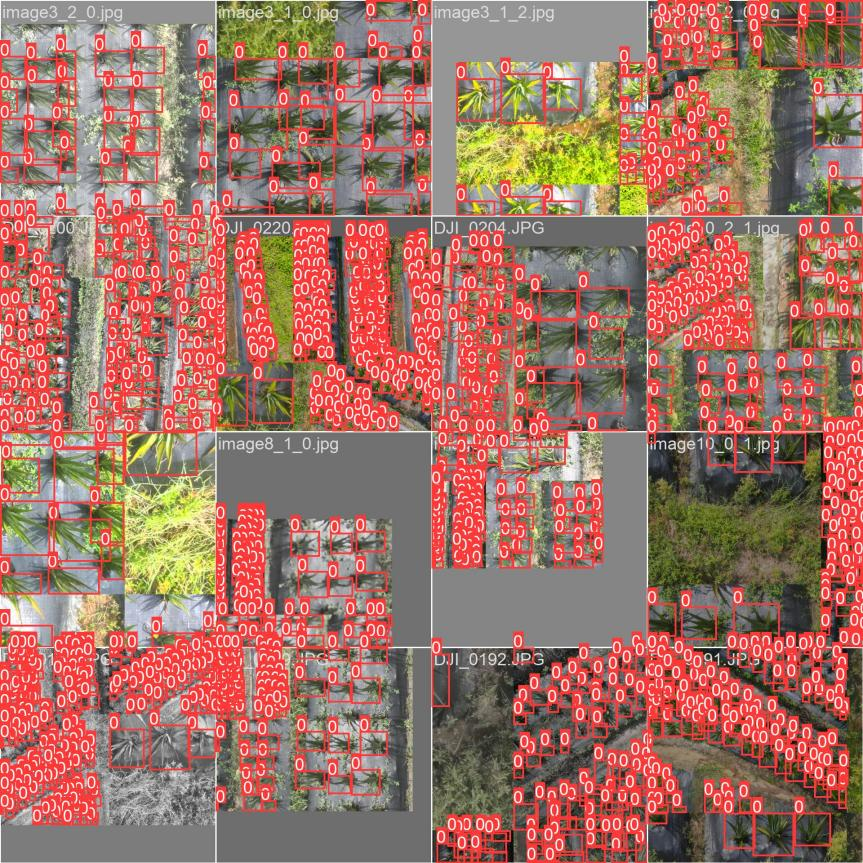

# 实验记录

本文件汇总毕业论文/答辩材料中的实验数据（**原始实验环境，非本仓库重新训练**），
以及本仓库可直接复现的实测项。所有来源均已标注。

## 1. 植株检测模型（AloeDet）

### 1.1 消融实验（来源：答辩 PPT）

| 模型 | mAP@50 (%) | 参数量 (M) |
| --- | --- | --- |
| Baseline (YOLOv11n) | 94.0 | 2.58 |
| + MCA 注意力 | 94.2 | 2.65 |
| + BiFPN | 94.3 | 2.45 |
| + C3k2-Faster | 94.1 | 1.89 |
| **Ours (Full)** | **94.5** | **1.89** |

### 1.2 与主流模型对比（来源：答辩 PPT）

| 模型 | mAP@50 (%) | 速度 (ms/img) |
| --- | --- | --- |
| Faster R-CNN | 95.1 | 120 |
| YOLOv8n | 93.8 | 45 |
| **Ours (改进 YOLOv11n)** | **94.5** | **42** |

### 1.3 论文口径（来源：论文 5.3.2 / 6.4）

- 相对基线：精确率 +0.6%，召回率 +1.7%，mAP@50 +0.5%，参数量 −26.7%，FLOPs −4.8%；
- 植株计数相对误差 3.8%（优化 NMS 参数后由 4.5% 降低）；
- 训练：300 epochs，batch 32，SGD(lr0=0.01, momentum=0.937, wd=5e-4)，Mosaic+MixUp。



*图：植株检测可视化示例（无人机航拍图像上的检测框，来自项目结题材料；
实际演示效果以本仓库训练出的模型为准）*

## 2. 病斑分割模型（AloeSeg）

### 2.1 消融实验（来源：答辩 PPT）

| 模型 | mask mAP (%) | 模型大小 (MB) |
| --- | --- | --- |
| Baseline (YOLOv11n-seg) | 74.1 | 6.3 |
| + DE 注意力 | 75.2 | 6.5 |
| + DCNv2 | 75.8 | 6.8 |
| + P2 检测头 | 75.5 | 7.1 |
| **Ours (Full，含轻量化分割头)** | **76.4** | **4.6** |

### 2.2 论文口径（来源：论文 5.3.3 / 6.4）

- 病斑分割精确率 82.5%（+5.3 个百分点），mask mAP 76.4%（+3.4），F1 +1.9%；
- 参数量 −27.9%，模型体积 6.0MB → 4.6MB；
- 病害五级分级准确率 92.3%；
- 训练：300 epochs，batch 16，SGD(lr0=0.01, momentum=0.937, wd=5e-4)，Mosaic。

## 3. 产量与减产率

- 50 个田间样方实测，多元线性回归 R² = 0.983，减产率预测相对误差 3.2%；
- 回归式：y = x1 + 0.818·x2 + 0.692·x3 + 0.307·x4。

## 4. 端侧与系统指标（来源：论文第 6 章）

| 项目 | 指标 |
| --- | --- |
| 云端推理（单图） | 检测 8ms / 分割 12ms |
| Android（骁龙 8 Gen 2） | 全流程 450ms/张（NCNN 离线推理） |
| Jetson Nano 边缘端 | 全流程 580ms/张（TensorRT FP16） |
| 硬件连续运行 | 30 天无故障，通信成功率 >99% |
| 功能测试 | 32 个用例全部通过 |

## 5. 本仓库重建版实测（可复现）

```bash
python -m aloe_vision.engine.benchmark --config configs/aloe-det-v11n.yaml
python -m aloe_vision.engine.benchmark --config configs/aloe-seg-v11n.yaml
python -m aloe_vision.engine.benchmark --config configs/yolo11n-baseline.yaml
python -m aloe_vision.engine.benchmark --config configs/yolo11n-seg-baseline.yaml
```

实测结果（CPU = Intel Core i5-14600KF，PyTorch 2.14.1+cpu，imgsz=640，单图时延为 20 次平均）：

| 模型 | 层数 | 参数量 | GFLOPs | CPU 时延 (ms/图) |
| --- | --- | --- | --- | --- |
| AloeDet（重建） | 204 | 2,321,735 | 5.7 | 51.0 |
| YOLO11n 基线（nc=80） | 181 | 2,624,080 | 6.7 | 33.6 |
| AloeSeg（重建） | 359 | 2,561,210 | 8.9 | 134.8 |
| YOLO11n-seg 基线（nc=80） | 203 | 2,876,848 | 10.0 | 42.7 |

口径说明（重要）：

- 基线为官方 nc=80 配置（与论文 2.58M / 2.88M 口径一致）；本仓库模型 nc=2（正常/倒伏）
  与 nc=1（病斑），类别数对齐后的基线参数量为 2,590,230 / 2,842,803，
  重建版相对 nc 对齐基线下降 10.4% / 9.9%；
- **与论文原始口径（−26.7% / −27.9%）存在差异**：论文中的网络结构图（图 5-2 / 图 5-3）
  未随文件保留，本仓库按论文文字描述重建（见 `docs/DESIGN.md` 第 5 节"重建边界"），
  实现细节差异导致参数量下降幅度小于论文；
- 分割模型新增 P2 检测头 / DCNv2 / 5 个 DE 注意力会带来参数与计算量增量，
  由轻量化分割头抵消一部分；DCNv2 的 offset/modulation 分支为零初始化，训练初期
  行为接近标准卷积；
- CPU 时延仅作相对参考（论文端侧口径：Android 450ms/张、Jetson Nano 580ms/张）；
- 精度类指标需在真实数据上训练后评估：本仓库未复现论文精度（自建数据集未开源），
  但提供了完整的训练/评估/推理流程与合成数据端到端冒烟测试。
