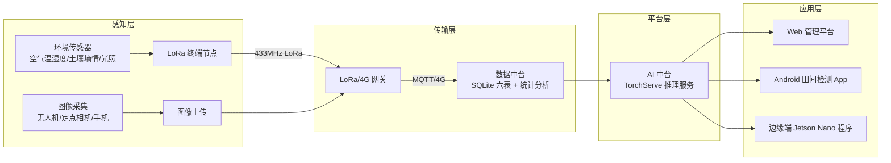
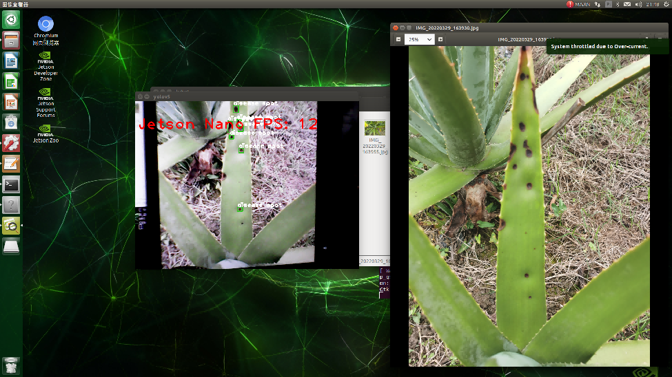

# 系统设计与实现：物联网监测平台（硬件 / 软件 / 三端应用）

> 对应毕业论文《基于物联网与深度学习的芦荟智慧农业监测系统》第 3–6 章。
> 本仓库开源的是**视觉算法核心**（见其余文档）；系统的硬件与工程部分代码未开源，
> 这里按论文整理为文档，用于完整了解项目全貌。涉及的具体型号/参数均来自论文文字描述，
> 论文中的结构图（图 3-1 / 图 5-1 等）未随文件保留。

## 1. 总体架构

系统采用物联网经典四层架构 + 深度学习算法体系，工作流如下：

- **感知层**：环境传感器网络 + 多尺度图像采集（无人机航拍 / 定点微单 / 手机）；
- **传输层**：LoRa 局域网汇聚 + 4G 广域网上云，网关负责协议转换、本地缓存与断点续传；
- **平台层**：数据中台（采集、存储、查询统计、设备与权限管理）+ AI 中台（模型管理、推理调度、接口服务、性能监控）；
- **应用层**：Web 数据管理平台、Android 田间检测程序、边缘端减产率预估程序。

## 2. 感知层

### 2.1 环境感知单元

采集空气温湿度、土壤温湿度、光照强度三类参数，全部支持 Modbus-RTU / RS485 总线组网：

| 传感器 | 型号 | 核心参数 | 防护 | 供电 |
| --- | --- | --- | --- | --- |
| 空气温湿度 | RS-WS-N01-2 | 温度 −40~80℃（±0.2℃）；湿度 0~100%RH（±2%RH） | IP67 | 10~30V DC |
| 土壤温湿度 | RS-ECTH-N01-TR-1 | 温度 −30~70℃（±0.2℃）；湿度 0~100%（±3%） | IP68 | 10~30V DC |
| 光照强度 | RS-GZ-N01-2 | 0~200000 lux（±5%），响应 ≤1s | IP65 | 10~30V DC |

- 空气温湿度与光照传感器装入气象百叶箱，土壤传感器探针式插入根部土层；
- 终端节点：E18-2G4M20S LoRa 模块（SX1278，433MHz，视距可达 3km），4 路 RS485，可接多路传感器；
- **供电**：太阳能板（10W 单晶硅，效率 ≥22%）+ 锂电池（12V/20Ah 磷酸铁锂）离网供电，阴雨天可连续工作 7 天以上，配充放电控制器防过充/过放/短路；
- **布点**：50m×50m 网格均匀布设，低洼积水与病害高发区加密；避开植株遮挡。

### 2.2 图像采集单元

| 模式 | 设备 | 采集方案 |
| --- | --- | --- |
| 无人机航拍 | DJI Mavic 3（哈苏相机，2000 万像素，46min 续航） | 正射俯拍，飞行高度 3/5/10m 梯度；井字形航线，旁向重叠 60%、航向重叠 70%；JPEG 5280×3956 + GPS 标记；覆盖晴/阴/雨天与不同光照 |
| 定点拍摄 | 索尼 α7c II 微单（3300 万像素） | 固定在病害高发区（三脚架 1m 高），定时自动拍摄；单株俯拍 + 单叶特写，JPEG 4000×4000；太阳能供电无人值守 |
| 移动端采集 | 安卓手机（主摄 ≥4800 万像素） | 田间巡检随手拍，单株俯拍/叶片直拍/斜拍；JPEG 1920×1080；图像链路与 Android 应用打通 |

## 3. 传输层

### 3.1 网关（USR-G806L）

| 参数类别 | 详细指标 |
| --- | --- |
| 通信接口 | 8 路 LoRa 通道、1 路 RS485、1 路以太网、1 路 4G 全网通 |
| 通信参数 | LoRa 433MHz（最远 3km）；4G 全网通 7 模，向下兼容 2G/3G |
| 硬件配置 | 32 位 ARM Cortex-M4 @120MHz，256KB RAM，16MB Flash |
| 供电与防护 | 9~36V DC，功耗 ≤5W；IP65，−30~75℃ |
| 功能特性 | Modbus-RTU ↔ Modbus-TCP 转换、本地缓存、断点续传、远程配置 |

网关硬件电路分五部分：宽压电源模块（DC-DC 5V/3.3V + 反接/过流/过压/静电保护）、
核心控制（STM32F407）、LoRa 集中器（SX1302，8 通道并行接收）、4G 模块（EC200S，MQTT）、
接口保护（TVS + 自恢复保险丝防雷击/浪涌）。供电为 30W 太阳能 + 12V/50Ah 磷酸铁锂，
支持市电/太阳能双电源自动切换。

### 3.2 组网与协议

- **拓扑**：星型组网，终端节点直连中心网关；网关安装于制高点（≥3m）配全向高增益天线；
  单网关最多 128 个终端、覆盖半径 3km，满足 500 亩以内基地；更大面积按区域多网关部署；
- **协议**：终端↔网关用 LoRa 私有帧（帧头 / 终端地址 / 功能码 / 数据长度 / 数据 / 校验 / 帧尾）；
  网关↔云平台用 MQTT（JSON 上行数据 + 订阅控制指令下行，双向交互）；
- **调试**：通信成功率 >99%，全流程平均延迟 ≤1.5s；4G 人为断开 2 小时后恢复，缓存数据自动补传、零丢失；调整唤醒/休眠机制降低终端功耗。

## 4. 平台层（Flask：数据中台 + AI 中台）

### 4.1 数据中台

- **数据接收与预处理**：MQTT 服务端接收传感器数据，HTTP 接口接收图像与分析结果；清洗、去异常、统一时间戳；
- **数据存储**：SQLite 六张核心表——环境监测 / 图像 / 模型分析结果 / 产量预估 / 设备信息 / 用户信息；支持定期备份与归档；
- **查询与统计**：按时间、田块、设备、病害等级多维筛选；Pandas/NumPy 做趋势与相关性分析；
- **设备管理**：注册、状态监控、远程配置、固件升级、故障告警，全生命周期管理；
- **用户与权限**：RBAC 三角色（超管/管理员/普通用户），MD5 加密存储密码，操作日志可查。

### 4.2 AI 中台

- **模型管理**：检测 / 分割 / 产量三类模型的版本、权重与配置管理，支持迭代与回滚；
- **推理调度**：基于 Ultralytics + TorchServe，批量推理 + 任务队列应对并发；
- **接口服务**：标准化 RESTful 推理 API（植株检测 / 病斑分割 / 产量预估），Token 鉴权，支持单图与批量；
- **性能监控**：推理耗时、吞吐、成功率、GPU 显存，异常告警与自动重启。

后端分层：数据访问层（SQLAlchemy）→ 业务逻辑层（数据/设备/模型调度/用户/统计/系统六模块）→ 接口服务层（Flask RESTful + 鉴权/校验/日志）。

## 5. 应用层（三端）

### 5.1 Web 端农田数据管理系统

面向管理人员，响应式设计（Bootstrap5 + Chart.js），六大模块：
数据可视化仪表盘（环境/植株/病害/产量指标卡片与图表）、环境监测（历史数据与报表导出）、
智能分析（检测/分割/产量历史结果与量化报告）、统计分析（病害规律、环境-病害相关性、产量趋势）、
设备管理（状态、远程配置、升级、日志）、系统管理（用户、权限、日志、备份恢复）。

### 5.2 Android 田间检测程序

面向种植户与巡检人员，适配 Android 8.0+，集成轻量化模型支持**离线推理**：

- 相机实时检测（Camera2 API）：拍照检测 + 视频流检测，输出植株数量、病害等级、病斑面积占比、
  预估减产率，画面叠加检测框与分割掩膜；
- 图像批量检测（相册选图）；结果管理（本地存储、筛选、报告、分享导出）；
- 数据同步（联网时上传云端）；使用说明（操作指引 + 炭疽病防控建议）。

### 5.3 边缘端减产率预估程序（Jetson Nano，PyQt5）

面向田间定点监测：USB 相机实时视频（25fps）采集与抓拍 → 植株检测计数（正常/倒伏）→
病斑分割与分级 → 产量与减产率预估 → 超阈值自动预警 → PyQt5 界面展示并同步云端。

*图：Jetson Nano 边缘端程序运行实拍（工控桌面 + PyQt 检测界面；来自项目结题材料）*

## 6. 端侧部署链路

| 平台 | 转换与推理 | 实测（论文） |
| --- | --- | --- |
| Android 手机（骁龙 8 Gen 2） | PyTorch → ONNX → NCNN 离线推理 | 全流程 450ms/张 |
| Jetson Nano 边缘端 | TensorRT FP16 engine | 全流程 580ms/张 |
| 云端服务器 | PyTorch + TorchServe | 检测 8ms / 分割 12ms 单图 |

此外使用模型剪枝与 INT8 权重量化进一步压缩模型体积。

## 7. 系统集成与测试

- **集成**：硬件联调（田间 5 套监测终端 + 1 台 LoRa/4G 网关 + 1 套 Jetson Nano）、
  模型封装为 RESTful API 接入平台、多端统一账号与数据同步（Web / Android / 边缘端互通）；
- **功能测试**：32 个用例（数据采集、设备管理、模型推理、Web、Android、边缘端六类）全部通过；
- **性能测试**：

| 项目 | 结果 |
| --- | --- |
| 模型精度 | 检测 mAP@50 94.5%，计数相对误差 3.8%；分割 mask mAP 76.4%，分级准确率 92.3%；减产率相对误差 3.2% |
| 推理实时性 | 云端 8ms/12ms；Android 450ms；Jetson Nano 580ms |
| 系统响应 | Web 加载 320ms、接口 150ms、图表渲染 480ms；100 并发推理成功率 99.8% |
| 数据传输 | 平均延迟 1.2s，成功率 99.6%，丢包率 0.4% |
| 稳定性 | 硬件与云端连续 30 天无故障，服务可用率 99.95% |

- **硬件专项测试（30 天）**：传感器误差全部在标称范围内；采集频率 10min/次无缺失；
  电池电量始终 ≥20%；数据传输成功率 99.5%（丢包 <0.5%）；Jetson Nano 连续运行 7 天无死机；
- **测试后优化**：弱光拍摄自动曝光补偿、密集植株 NMS 参数调整（计数误差 4.5%→3.8%）、
  Web 大数据量分页/懒加载、交互简化（图文指引、结果展示优化）。

## 8. 不足与展望（论文口径）

- **不足**：病害种类仅覆盖炭疽病（2–3 种）；数据集来自单一基地，跨地域/品种泛化待验证；
  尚无执行端闭环控制；未探索 Transformer 等新架构；
- **展望**：扩展多病害识别与分割、跨基地数据与联邦学习、水肥一体化闭环控制、
  视觉大模型与小样本学习、无人机自主巡航的空地一体化监测网络。
